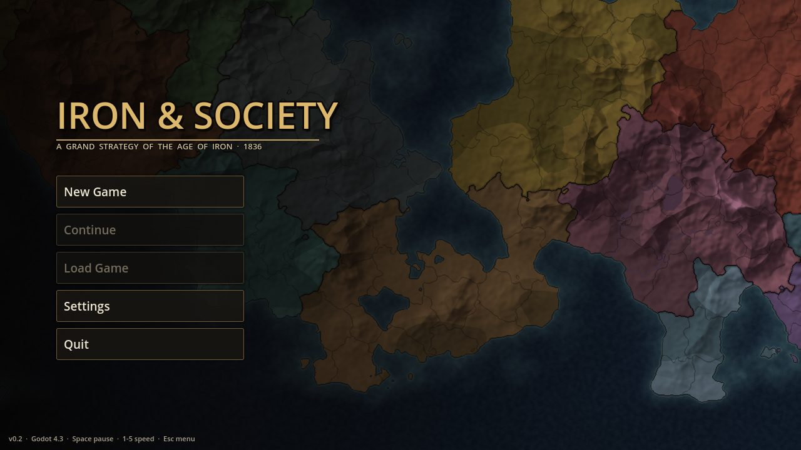
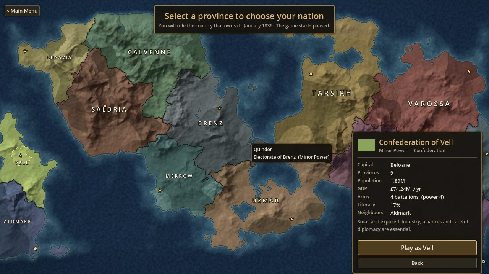
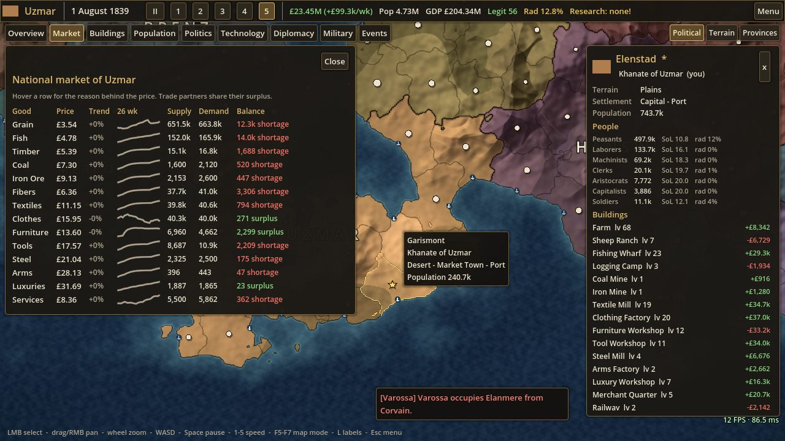
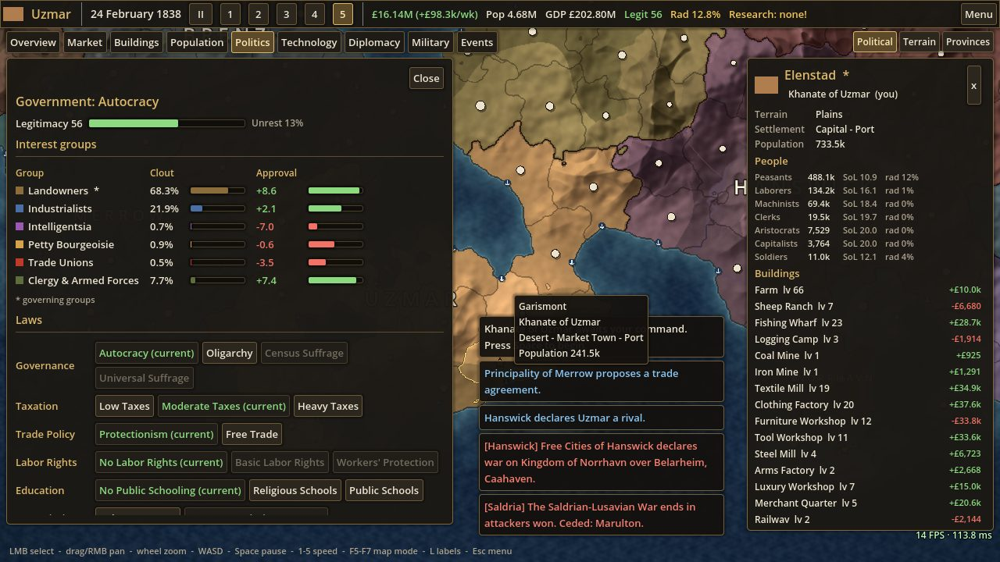

# Iron & Society

A performance-first historical grand-strategy game (Godot 4.3, Compatibility renderer, GDScript).
**Current state: playable vertical slice.** Main menu, province-based nation pick, then a monthly/weekly
simulation of population, a market economy, politics, technology, diplomacy/war and AI countries,
with save/load. Fictional 1836-style world of 14 countries and 205 provinces.

| Menu | Nation pick |
|---|---|
|  |  |
|  |  |

## Requirements
- Godot **4.3-stable** (standard build, not .NET). Uses the `gl_compatibility` renderer (OpenGL 3.3), which fits the target GPU class (Radeon R7 350).

## Run
```sh
godot --path .                       # main menu: New Game / Continue / Load Game / Settings / Quit
godot --path . -- --benchmark        # scripted map benchmark, prints results and quits
godot --path . -- --low              # disables ocean animation + vignette
```
Or open `project.godot` in the editor and press F5.

**New Game**: click any province, then *Play as ...*: you rule the country that owns it. The game starts paused
(press Space). **Continue** loads the newest save (autosave is monthly by default; Settings changes this).

### Controls
| Input | Action |
|---|---|
| LMB | select province (opens the province card) |
| drag LMB/RMB/MMB, WASD / arrows | pan |
| wheel | zoom to cursor |
| `Space` | pause / resume |
| `1`-`5` | speed 1 (1 day/s), 2 (3), 3 (8), 4 (20), 5 (maximum) |
| `+` / `-` | faster / slower |
| `F5` / `F6` / `F7` | map mode: Political / Terrain / Provinces |
| `L` | toggle labels |
| `F3` | cycle performance overlay (off / compact / detailed) |
| `F9` | map benchmark |
| `Esc` | close dialog / clear selection / pause menu |

Top-bar tabs: Overview (budget, taxes), Market, Buildings (queue construction), Population, Politics (laws, interest groups),
Technology (pick research), Diplomacy (relations, alliances, trade, claims, war and peace), Military, Events.

### Dev / CI arguments (after `--`)
`--autostart=N` skip menu and pick, play country N - `--continue` load the newest save - `--newgame` go straight to nation pick -
`--tab=overview|market|buildings|population|politics|technology|diplomacy|military|events` - `--speed=0..5` -
`--run-days=N` simulate N days before the first frame - `--pause-menu` - `--open=settings|load` (menu) -
`--select=P` select province - `--view=x,y,zoom` - `--mode=0..2` - `--shot=path.png [--shot-delay=s]` save a screenshot and quit -
`--monkey=SECONDS` UI fuzzer (random tabs and buttons while running) - `--benchmark` - `--low`.

## Tests
```sh
sh tests/run_all.sh                                           # both suites below; exit code 0 = pass
godot --headless --path . --script res://tests/run_tests.gd      # world, sim core, economy, population, saves
godot --headless --path . --script res://tests/test_strategy.gd  # politics, tech, diplomacy, war, AI, determinism + save
godot --headless --path . --script res://tools/sim_benchmark.gd  # 5-year sim: per-subsystem tick cost, save size
```
Always wrap headless runs in `timeout` (a script error can leave Godot hanging), e.g. `timeout 400 godot --headless ...`.
Rendered run under Xvfb:
`timeout 90 xvfb-run -a -s "-screen 0 1280x720x24" godot --path . --audio-driver Dummy --rendering-driver opengl3 -- --autostart=3 --run-days=365 --tab=market --shot=/tmp/a.png`

## Regenerate the world
The map is baked offline, so no generation happens at runtime:
```sh
godot --headless --path . --script res://tools/generate_world.gd [-- --seed=1836 --provinces=220 --size=2048]
```
Output goes to `data/generated/` (terrain + province-ID images as compressed `.res`, plus `world.json`).

## Export
`export_presets.cfg` defines **Windows Desktop** and **Linux** presets (the `include_filter` packs
`data/scenario/*.json` and `data/generated/*.json`, which are not Godot resources). Install the 4.3 export templates, then:
```sh
godot --headless --path . --export-release "Windows Desktop" build/windows/IronAndSociety.exe
godot --headless --path . --export-release "Linux" build/linux/IronAndSociety.x86_64
```
Saves go to `user://saves/` (`~/.local/share/godot/app_userdata/Iron & Society/saves/` on Linux).

## Layout
```
project.godot            engine config (Compatibility renderer, 1280x720, autoload Session)
scenes/main_menu.tscn    main scene -> src/ui/main_menu.gd
scenes/game.tscn         game scene -> src/main.gd (map + HUD + controller)
docs/GAMEPLAY_SPEC.md    module contracts (simulation, AI, UI); docs/DEVLOG.md decisions + measurements
src/game/                session.gd (autoload: scene flow, new/load/save), game_controller.gd (speed, time-sliced
                         stepping), settings.gd, monkey.gd (dev UI fuzzer)
src/sim/                 game_state.gd (calendar, module wiring, events), population.gd, economy.gd, politics.gd,
                         technology.gd, diplomacy.gd, military.gd, ai.gd, save_system.gd, sim_util.gd
src/ui/                  main_menu.gd, nation_pick.gd, game_hud.gd (top bar, tabs, toasts), ui_kit.gd, settings_screen.gd,
                         perf_overlay.gd, panels/*.gd (one per tab, pause menu, save/load dialog, province card)
src/world/               biome.gd, id_codec.gd, world_generator.gd (offline), world_data.gd (runtime tables)
src/map/                 map_view.gd + map.gdshader (whole map = 1 quad), map_camera.gd, map_overlay.gd
src/benchmark/           map_benchmark.gd
tools/                   generate_world.gd, sim_benchmark.gd
tests/                   run_tests.gd, test_strategy.gd, run_all.sh (+ fake_state/fake_pops helpers)
data/scenario/           countries, goods, buildings, laws, interest groups, techs (JSON)
data/generated/          baked map assets
TODO.md                  prioritised backlog
```
