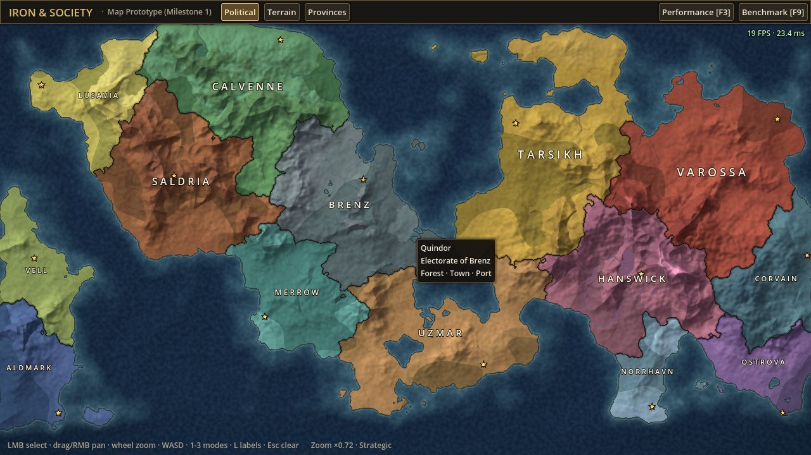

# Iron & Society

A performance-first historical grand-strategy game (Godot 4.3, Compatibility renderer, GDScript).
**Current state: Milestone 1, a playable 2.5D political map. There's no simulation yet.**



## Requirements
- Godot **4.3-stable** (standard build, not .NET). Uses the `gl_compatibility` renderer (OpenGL 3.3), which fits the target GPU class (Radeon R7 350).

## Run
```sh
godot --path .                     # play
godot --path . -- --benchmark      # scripted map benchmark, prints results and quits
godot --path . -- --low            # disables ocean animation + vignette
```
Or open `project.godot` in the editor and press F5.

Controls: LMB select province/country · drag (LMB/RMB/MMB) pan · wheel zoom to cursor · WASD/arrows pan ·
`1/2/3` Political/Terrain/Provinces map modes · `L` labels · `F3` cycle perf overlay (off/compact/detailed) ·
`F9` benchmark · `Esc` clear selection.

## Tests
```sh
godot --headless --path . --script res://tests/run_tests.gd   # exit code 0 = pass
```

## Regenerate the world
The map is baked offline, so no generation happens at runtime:
```sh
godot --headless --path . --script res://tools/generate_world.gd [-- --seed=1836 --provinces=220 --size=2048]
```
Output goes to `data/generated/` (terrain + province-ID images as compressed `.res`, plus `world.json`).

## Export
`export_presets.cfg` defines **Windows Desktop** and **Linux** presets. Install the 4.3 export templates, then run:
```sh
godot --headless --path . --export-release "Windows Desktop" build/windows/IronAndSociety.exe
```

## Layout
```
project.godot            engine config (Compatibility renderer, 1280x720)
scenes/main.tscn         single root scene -> src/main.gd
src/main.gd              composition root + cross-system input
src/world/               biome.gd, id_codec.gd, world_generator.gd (offline), world_data.gd (runtime tables)
src/map/                 map_view.gd + map.gdshader (whole map = 1 quad), map_camera.gd, map_overlay.gd
src/ui/                  hud.gd (top bar, info panel, tooltip), perf_overlay.gd
src/benchmark/           map_benchmark.gd
tools/generate_world.gd  bakes data/generated/*
tests/run_tests.gd       headless test runner
data/scenario/           hand-authored scenario definitions (countries)
data/generated/          baked map assets
docs/                    DEVLOG.md (decisions, measurements, limitations), screenshots, benchmark JSON
TODO.md                  prioritised backlog
```
